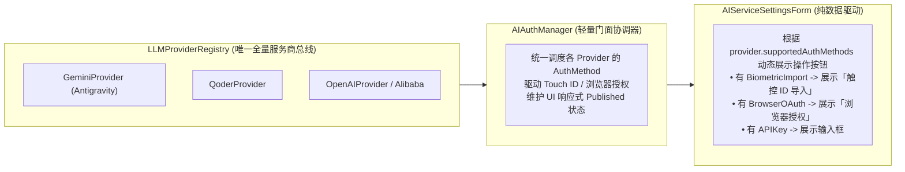
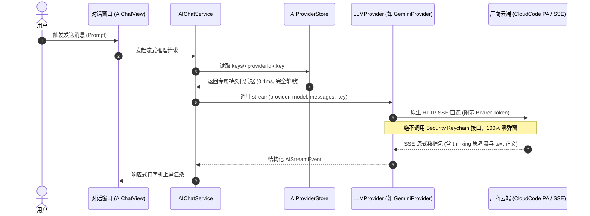

# QuickShow AI 供应商与多授权方式架构设计方案

## 1. 概述与核心诉求

### 1.1 背景与现状痛点
在 QuickShow 的前期演进过程中，围绕 AI 模型的接入与鉴权逐渐累积了若干深层次架构缺陷：
1. **钥匙串密码弹窗骚扰**：
   - 底层代码试图跨进程调用 macOS Keychain 接口（`SecItemCopyMatching`）读取外部工具写入的私有密钥（`service: "gemini"`）。
   - macOS 内核的 `securityd` 访问控制列表（ACL）机制判定 QuickShow 为未授权第三方，强制拦截并弹出“请输入登录钥匙串密码”窗口。
   - 本地重新编译导致应用代码签名哈希（cdhash）发生变动，使得用户的“始终允许”授权失效，导致每次使用或重启后都重复索要密码。
2. **凭据与配置散落严重**：
   - 存在 5 种互不统一的存取路径（`keys/`、`ai_api_key.txt`、外部 `~/.gemini/`、外部 `~/.local/share/opencode/`、外部钥匙串以及多个环境变量）。
   - 违背了应用封装自治原则，使得应用状态极度脆弱且难以排查。
3. **架构概念割裂（双轨制平行冗余）**：
   - 负责网络通信与流式解析的代码被抽象为 `LLMProvider`；
   - 负责认证探测的代码被平行塞在 `AIAuthManager` 中；
   - 造成同一个供应商在两个平行的字典中靠字符串匹配，使用方（UI、会话服务）不得不两头依赖；
4. **单供应商多授权方式的现实诉求**：
   - 现代化大模型供应商（如 Google Antigravity、阿里通义灵码 Qoder）天然**支持多种并存的授权渠道**（手动录入 API Key、本地凭据 + Touch ID 免密导入、浏览器 Web OAuth 登录、环境变量注入等）；
   - 之前的设计把供应商与单一认证类生硬绑定，缺少对“授权方式（AuthMethod）”独立的一等公民抽象。

---

## 2. 核心架构设计原则（First Principles）

```
                     ┌──────────────────────────────────────────────┐
                     │         LLMProvider (大模型服务商)            │
                     │  统一能力主体：集通信推理与多授权策略于一体   │
                     └──────────────────────┬───────────────────────┘
                                            │ 1 拥有 N 个
                                            ▼
                     ┌──────────────────────────────────────────────┐
                     │          AIAuthMethod (授权方式接口)          │
                     │  一等公民：支持 API Key / TouchID / 浏览器等  │
                     └──────────────────────┬───────────────────────┘
                                            │ 验证通过即落盘
                                            ▼
                     ┌──────────────────────────────────────────────┐
                     │   Single Source of Truth: keys/<id>.key      │
                     │   专属安全存储 (POSIX 0600) -> 运行时完全静默 │
                     └──────────────────────────────────────────────┘
```

1. **统一主体原则（High Cohesion）**：
   - 大模型服务商（`LLMProvider`）是唯一的业务能力实体，统一聚合通信推理（Inference Engine）与多套授权策略（Auth Methods）。
2. **授权方式一等公民（1-to-N Aggregation）**：
   - `AIAuthMethod` 抽象为独立的策略协议；
   - 每个 Provider 自主声明其所支持的一组 `[any AIAuthMethod]`，支持未来零侵入横向扩充。
3. **单一真源与零打扰安全存储（Single Source of Truth）**：
   - 无论通过指纹导入、浏览器登录还是手动输入，凭据一律收拢写入 `~/Library/Application Support/QuickShow/keys/<providerId>.key`（POSIX `0600`）；
   - 运行时发起对话 100% 只读本地专属文件，彻底切断运行期对系统 Keychain 的访问，达成真正的**零密码弹窗、重启免打扰**。
4. **UI 纯数据驱动渲染（Data-Driven UI）**：
   - 设置界面根据当前选中的 Provider 所暴露的 `supportedAuthMethods` 动态自适应渲染操作组件，彻底消灭 UI 中针对特定厂商的 hardcoded 判断。

---

## 3. 详细接口与领域模型设计

### 3.1 授权方式类型体系 (`AIAuthMethod`)

```swift
/// 授权方式类别
enum AuthMethodKind: String, Sendable, CaseIterable {
    case apiKey           // 手工输入 API Key / 个人访问令牌 PAT
    case biometricImport  // 本地已登录凭据探测 + 触控 ID (Touch ID) 验证导入
    case browserOAuth     // 浏览器外部授权 (OAuth PKCE 或 Device Code Flow)
    case environment      // 系统终端环境变量自动装载
}

/// 统一授权方式基础契约 (面向接口)
protocol AIAuthMethod: Sendable {
    /// 方式分类
    var kind: AuthMethodKind { get }

    /// 人类可读名称 (如 "API Key 密钥", "触控 ID 免密导入", "🌐 浏览器登录授权")
    var displayName: String { get }

    /// 辅助提示文案
    var detailDescription: String { get }

    /// 当前方式在本机当前环境下是否可用 (例如是否探测到本地凭据、系统硬件是否支持生物识别)
    func isAvailable() async -> Bool
}

/// 本机环境探测与生物识别 (Touch ID) 导入专门协议
protocol BiometricImportAuthMethod: AIAuthMethod {
    /// 静默探测本机已安装环境或已登录凭据 (完全静默、绝不调用弹窗接口)
    func detectLocalAccount() async -> LocalDetectedAccount?

    /// 在机主通过 Touch ID / 锁屏密码验证后，提取并标准化凭据
    func importViaBiometrics(detected: LocalDetectedAccount) async throws -> AuthCredentials
}

/// 交互式浏览器外部授权协议 (OAuth 2.0 PKCE / Device Flow)
protocol InteractiveBrowserAuthMethod: AIAuthMethod {
    /// 启动浏览器授权流程
    func startBrowserAuthorization(
        onStateChange: @escaping @Sendable (AIAuthManager.AuthState) -> Void,
        onSuccess: @escaping @Sendable (AuthCredentials) -> Void
    ) async throws

    /// 取消授权并释放网络/轮询资源
    func cancelAuthorization()
}

/// 手工录入 API Key 协议
protocol APIKeyAuthMethod: AIAuthMethod {
    /// 校验 Key 格式是否合法
    func validate(key: String) -> Bool
    
    /// 占位提示与帮助文案
    var placeholder: String { get }
}
```

---

### 3.2 大模型供应商协议扩展 (`LLMProvider`)

```swift
/// 大模型服务提供商通用协议 (聚合通信推理与多授权方式)
protocol LLMProvider: Sendable {
    /// 该 Provider 所对应的服务商类型
    var providerType: AIProviderType { get }

    /// 该服务商支持的多套授权方式列表 (1 对多聚合)
    var supportedAuthMethods: [any AIAuthMethod] { get }

    /// 发起流式推理请求
    func stream(
        provider: AIProvider,
        model: AIModelSpec,
        messages: [ChatCompletionMessage],
        options: AIChatRequestOptions,
        apiKey: String
    ) -> AsyncThrowingStream<AIStreamEvent, Error>

    /// 从端点拉取该供应商可用模型列表
    func fetchModels(
        provider: AIProvider,
        apiKey: String
    ) async throws -> [String]

    /// 思考档位与模型参数适配
    func thinkingFields(
        for modelId: String,
        level: ThinkingLevel?
    ) -> [String: Any]
}
```

---

### 3.3 各供应商的具体授权方式矩阵

| 供应商 | 协议类型 | 包含的授权方式 | 机制实现细节 |
| :--- | :--- | :--- | :--- |
| **Google Antigravity** | `.antigravityNative` | 1. `StandardAPIKeyMethod`<br>2. `AntigravityBiometricMethod`<br>3. `AntigravityGooglePKCEMethod` | • 手工输入 AI Studio Key (`AIzaSy...`)<br>• 本地静默读取 `~/.gemini/jetski-standalone-oauth-token` + Touch ID 提取<br>• 基于本地回环服务器（`OAuthLoopbackServer`）与 Google PKCE 的浏览器授权 |
| **通义灵码 Qoder** | `.qoderNative` | 1. `StandardAPIKeyMethod`<br>2. `QoderBiometricMethod`<br>3. `QoderDeviceFlowMethod` | • 手工输入 PAT 令牌<br>• 嗅探 `~/.qoder/.qoder-app-status.json` + Touch ID 提取<br>• 官方设备码 Web 确认流程（双端点并发轮询与 UserInfo 解析） |
| **阿里云百炼 (DashScope)** | `.openAICompatible` | 1. `StandardAPIKeyMethod`<br>2. `AlibabaLegacyMigrationMethod` | • 手工录入 DashScope API Key (`sk-...`)<br>• 环境变量 `DASHSCOPE_API_KEY` 注入<br>• 存量旧版文件自动透明迁移至 `keys/alibaba.key` |
| **OpenAI / 通用网关** | `.openAICompatible` | 1. `StandardAPIKeyMethod` | • 手工录入标准 API Key<br>• 环境变量 `OPENAI_API_KEY` 兜底 |

---

## 4. 全局协调与使用方分流架构

### 4.1 协调器与注册总线分工



1. **`LLMProviderRegistry`**：
   - 负责注册和持有各个 `LLMProvider`；
   - 作为全应用唯一的服务商能力提供源，消灭所有平行的私有映射。
2. **`AIAuthManager`**：
   - 彻底脱去具体业务代码，仅作为面向 SwiftUI 的**门面协调器**；
   - 当需要刷新本地探测状态时，直接向 `LLMProviderRegistry` 遍历所有 Provider 拥有的 `BiometricImportAuthMethod`；
   - 当用户点击授权时，唤起系统原生 Touch ID（`LocalAuthentication`），验证成功后委派对应方式执行落盘；
   - 统一管理 `authStates` 和 `detectedAccounts` 发布，驱动 UI 刷新。

---

## 5. 安全存储与运行时流转规范

### 5.1 存储分层规范
- **第一层：轻量用户偏好（`UserDefaults.standard` / `SettingsStore`）**
  - 仅用于存储一瞥时长、快捷键定义、外观主题、微标开关等标量偏好；
  - 严禁将大块数据或密钥写入 UserDefaults。
- **第二层：结构化业务配置（`Application Support/QuickShow/*.json`）**
  - 模型矩阵与厂商元数据：`providers.json`
  - 智能体角色定义：`agents.json`
- **第三层：受保护机密凭据（`Application Support/QuickShow/keys/`）**
  - `keys/<providerId>.key`：保存 API Key 或 OAuth Access Token；
  - `keys/<providerId>.account.json`：保存绑定的用户信息与元数据；
  - 扩展工具：`keys/amap.key`、`keys/tavily.key`；
  - **访问权限**：强制设定 POSIX `0600` 权限（仅当前机主用户自身的进程拥有读写权限）。

### 5.2 运行时交互调用时序



---

## 6. 重构分步落地实施路线

1. **第一阶段：协议与多授权方式抽象（已定义）**：
   - 声明 `AIAuthMethod` 协议族；
   - 扩展 `LLMProvider` 协议，增加 `supportedAuthMethods` 属性。
2. **第二阶段：具体服务商实现拆解**：
   - 将现有 `AntigravityAuthenticator` 拆解为 `AntigravityBiometricMethod` 与 `AntigravityGooglePKCEMethod`，内聚至 `GeminiProvider`；
   - 将现有 `QoderAuthenticator` 拆解为 `QoderBiometricMethod` 与 `QoderDeviceFlowMethod`，内聚至 `QoderProvider`；
   - 将 `AlibabaAuthenticator` 内聚至 `OpenAIProvider` 对应的衍生配置。
3. **第三阶段：`LLMProviderRegistry` 与 `AIAuthManager` 协同**：
   - `LLMProviderRegistry` 暴露全量 Providers 查询；
   - `AIAuthManager` 移除内置的硬编码实例数组，全部动态从 Registry 获取。
4. **第四阶段：设置面板 UI 数据驱动重构**：
   - `AIServiceSettingsForm` 动态根据当前 Provider 的 `supportedAuthMethods` 渲染操作卡片与按钮，消灭最后一处厂商类型 switch 分支。
