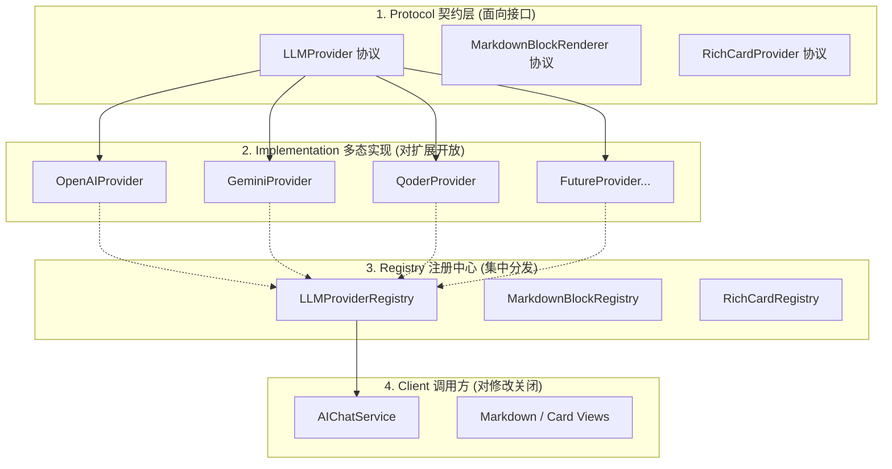
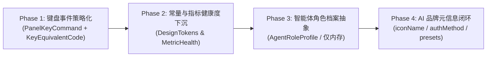

# QuickShow 架构重构与 SOLID 开闭原则治理蓝图

> **文档定位**：本规范是 QuickShow 工程遏制代码腐化、消除魔法数字、统一场景与类型派发的**长期对照与重构实施基准**。任何新增业务能力与重构改动均须以此为准绳，严格对齐 SOLID 原则与面向协议的策略扩展体系。
>
> **最后 Review**：2026-10-19（人工深度对码审查，修正 7 处原方案设计错误）

---

## 0. 核心设计原则与工程法则

### 1. SOLID 原则优先（尤其是开闭原则 OCP）
- **开闭原则（Open-Closed Principle, OCP）**：软件实体（类、模块、函数）应该**对扩展开放，对修改关闭**。
  - 新增一个供应商、一种卡片、一个按键命令或一个智能体角色时，**绝不应去修改现有的中央调度代码或上层调用方**，而应仅通过**新增一个遵循统一协议的实现类并将其注册到调度中心**来实现即插即用。
- **单一职责原则（Single Responsibility Principle, SRP）**：
  - 视图层（SwiftUI View）只负责"如何展示"（声明式布局与样式绑定）；
  - 领域模型（Model/Store）负责"数据状态与业务语义推导"（如当前指标是正常还是告警）；
  - 调度器（Registry/Dispatcher）负责"如何路由"，各司其职，坚决杜绝在 View 的计算属性里硬编码复杂的阈值判断与业务决策。

### 2. "第二次出现"工程法则（The Second-Time Rule）
- **第一次出现**：某个特化逻辑或简单场景分支初次引入时，可以保持轻量实现，不过度设计；
- **第二次出现**：系统内一旦出现**第二处同类场景判定、类型嗅探、前缀匹配或大块结构复制**，**严禁继续写第三个分支或再次复制**，必须立即停下来进行抽象设计，引入协议与注册中心分发机制。

### 3. 杜绝任何形式的魔法数字与硬编码
- 裸写键码（如 `keyCode == 46`）、业务阈值（如 `usage > 85`）、时间常量（如 `1.2` 秒）、布局数值等一律视为代码坏味道；
- 所有按键事件收敛为语义化枚举或强类型 Command；所有时间、颜色与网格常量收敛至 [`DesignTokens.swift`](file:///Users/admin/Projects/all-in-ai/quick-time/QuickShow/Utilities/DesignTokens.swift)（`Theme`）或领域策略模型。

---

## 1. 标杆案例：工程现有最佳实践解析

QuickShow 工程中已经存在三个严格践行 OCP 与策略模式的典范，后续所有模块治理均需以此三者为蓝本：



1. **[`LLMProvider`](file:///Users/admin/Projects/all-in-ai/quick-time/QuickShow/AI/Providers/LLMProvider.swift#L7-L34) & [`LLMProviderRegistry`](file:///Users/admin/Projects/all-in-ai/quick-time/QuickShow/AI/Providers/LLMProvider.swift#L38-L67)**：
   - **抽象**：将推理流、模型拉取、思考字段适配抽象为 `LLMProvider` 协议；
   - **分发**：`LLMProviderRegistry` 集中注册与查找，调用方 `AIChatService` 无需知道底层通信差异；
2. **[`MarkdownBlockRegistry`](file:///Users/admin/Projects/all-in-ai/quick-time/QuickShow/Views/Markdown/Core/MarkdownBlockRegistry.swift#L5-L60)**：
   - **抽象**：定义 `MarkdownBlockRenderer`（优先级、`canRender`、`renderWidget`、间距节奏）；
   - **分发**：AST 遍历时通过注册表按匹配度分发，新增 Markdown 语法块零侵入已有渲染器；
3. **[`RichCardRegistry`](file:///Users/admin/Projects/all-in-ai/quick-time/QuickShow/AI/RichCard.swift#L25-L100)**：
   - **抽象**：定义卡片信封 `RichCard` 与 `RichCardProvider`；
   - **分发**：根据信封 `type` 查找视图工厂，新增地图卡、天气卡、图表卡无需在会话视图增加 `if-else`。

---

## 2. 治理重灾区与重构蓝图对照

| 领域模块 | 现状坏味道 (Before) | 重构方案 (After / OCP) |
| :--- | :--- | :--- |
| **1. 键盘盲操事件**<br>([`PanelManager.swift`](file:///Users/admin/Projects/all-in-ai/quick-time/QuickShow/Core/PanelManager.swift#L121-L187)) | `onKeyDownAction` 内 **14 个** `switch keyCode` 裸数字分支<br>（注：contextHotkeys 注册表与独立闭包已是 OCP，不在治理范围） | `PanelKeyCommand` 策略协议<br>`PanelKeyCommandRegistry` 注册表动态分发 |
| **2. AI 品牌元信息**<br>([`AIProvider.swift`](file:///Users/admin/Projects/all-in-ai/quick-time/QuickShow/AI/Providers/AIProvider.swift#L207-L228)) | `iconName` 6 级 `contains` 字符串猜测；`addModelFromAvailable` 字符串嗅探能力；`resetToPresetModels` 4 级 if-else；`formatAuthMethodTag` 字符串 switch；表单 2 处 `switch type` | `iconName` 由 preset 工厂直接给定（强类型）；`authMethod: String → AuthMethodKind` 枚举；`AIProvider` 自持 `presetModels` 工厂，消灭外部 if-else |
| **3. 智能体与角色体系**<br>([`AIAgent.swift`](file:///Users/admin/Projects/all-in-ai/quick-time/QuickShow/AI/Agents/AIAgent.swift#L46-L180)) | `switch roleId` 映射工具；`switch subagentId` 映射图标；<br>两份复制粘贴的 `defaultAgents()` | `AgentRoleProfile` 角色模板策略<br>（纯内存构造，不参与 Codable）<br>自适应当前 Provider 智能装配 |
| **4. 监控指标健康度与常量**<br>([`PerformanceCard.swift`](file:///Users/admin/Projects/all-in-ai/quick-time/QuickShow/Views/PerformanceCard.swift#L380-L394)) | View 散落 `>85` / `>60` 阈值；<br>`1.2s` 复制反馈时间硬编码 5 处 | `MetricHealthLevel` 语义化模型<br>常量下沉至 `Theme.Motion` 与领域模型 |

---

### 重灾区 1：按键盲操事件链（[`PanelManager.swift`](file:///Users/admin/Projects/all-in-ai/quick-time/QuickShow/Core/PanelManager.swift#L111-L187)）

> [!IMPORTANT]
> 真实按键架构有**三层**，仅第二层需要治理：
> - **第一层（已是 OCP）**：`AppState.contextHotkeys[keyCode]` 注册表（L116-L120），上下文直达键（如 G → 日历）通过注册表分发，**无需重构**；
> - **第二层（需治理）**：`switch keyCode` 内 **14 个** `case`（L121-L186），裸 UInt16 魔数、业务逻辑杂糅；
> - **第三层（已是 OCP）**：Space / Tab / ESC / ⌘Q / ? 等各自是独立的 `panel.onSpacePressed` 等闭包，**不在 switch 内，无需治理**。

#### 现状问题（Before）
在 [`PanelManager.swift:121-186`](file:///Users/admin/Projects/all-in-ai/quick-time/QuickShow/Core/PanelManager.swift#L121-L186) 中，`onKeyDownAction` 内有 14 个 case：
- **裸数字不可读**：`case 46`（M）、`case 126`（Up Arrow）、`case 0`（A）、`case 8`（C）、`case 35`（P）、`case 31`（O）、`case 7`（X）、`case 37`（L）、`case 2`（D）、`case 34`（I）、`case 36`（⏎）、`case 123/124`（方向键）、`case 43/47`（逗号/句号）、`case 18/19/20`（1/2/3）；
- **上下文优先级硬编码杂糅**：
  ```swift
  case 123: // ← 左方向键
      if appState.currentContext == .calendar {  // 日历优先翻页
          appState.calendarPageBackward()
          return true
      }
      appState.mediaPreviousTrack()              // 其余情况：媒体上一首
      return appState.hasNowPlayingSession
  ```

#### 重构方案（After / OCP）

1. **强类型按键与命令协议**：
   ```swift
   /// 语义化键码定义（彻底消灭裸 UInt16）
   enum KeyEquivalentCode: UInt16, Sendable {
       case a = 0, d = 2, x = 7, c = 8, i = 34, returnKey = 36, l = 37
       case p = 35, o = 31, m = 46, comma = 43, dot = 47
       case num1 = 18, num2 = 19, num3 = 20
       case leftArrow = 123, rightArrow = 124, downArrow = 125, upArrow = 126
   }

   /// 键盘命令策略协议
   protocol PanelKeyCommand: Sendable {
       var id: String { get }
       var key: KeyEquivalentCode { get }
       var modifiers: NSEvent.ModifierFlags { get }
       var priority: Int { get } // 优先级数值越高越先裁决

       /// 是否在当前应用状态与上下文中生效
       func canHandle(in context: PanelContext, state: AppState) -> Bool

       /// 执行动作，返回 true 表示消费该事件（不向底层系统传递）
       func execute(state: AppState) -> Bool
   }
   ```

2. **命令注册表分发总线**：
   ```swift
   @MainActor
   final class PanelKeyCommandRegistry {
       static let shared = PanelKeyCommandRegistry()
       private var commands: [PanelKeyCommand] = []

       func register(_ command: PanelKeyCommand) {
           commands.append(command)
           commands.sort { $0.priority > $1.priority }
       }

       func handle(event: NSEvent, context: PanelContext, state: AppState) -> Bool {
           guard let key = KeyEquivalentCode(rawValue: event.keyCode) else { return false }
           let mods = event.modifierFlags.intersection([.command, .option, .shift, .control])
           for command in commands where command.key == key && command.modifiers == mods {
               if command.canHandle(in: context, state: state) {
                   return command.execute(state: state)
               }
           }
           return false
       }
   }
   ```

3. **优先级裁决示例**：左方向键在日历/媒体两种场景下的优先级通过 `priority` 和 `canHandle` 优雅裁决，无需在同一分支写 if-else：
   ```swift
   // 日历翻页命令（priority: 100，高优先级）
   struct CalendarPageBackwardCommand: PanelKeyCommand {
       let key = KeyEquivalentCode.leftArrow
       let modifiers = NSEvent.ModifierFlags()
       let priority = 100
       func canHandle(in context: PanelContext, state: AppState) -> Bool {
           context == .calendar
       }
       func execute(state: AppState) -> Bool {
           state.calendarPageBackward(); return true
       }
   }

   // 媒体上一首命令（priority: 50，低优先级，日历激活时被拦截）
   struct MediaPreviousTrackCommand: PanelKeyCommand {
       let key = KeyEquivalentCode.leftArrow
       let modifiers = NSEvent.ModifierFlags()
       let priority = 50
       func canHandle(in context: PanelContext, state: AppState) -> Bool { true }
       func execute(state: AppState) -> Bool {
           state.mediaPreviousTrack(); return state.hasNowPlayingSession
       }
   }
   ```

4. **效果**：[`PanelManager`](file:///Users/admin/Projects/all-in-ai/quick-time/QuickShow/Core/PanelManager.swift) 的键盘事件处理从 60 行简化为 5 行，并与现有 `contextHotkeys` 第一层并列运行，互不干扰：
   ```swift
   panel.onKeyDownAction = { [weak appState] event in
       guard let appState = appState else { return false }
       appState.resetGlanceTimer()
       // 第一层：contextHotkeys 注册表（已有，保持不动）
       if let context = AppState.contextHotkeys[event.keyCode],
          event.modifierFlags.intersection([.command, .option, .shift, .control]).isEmpty {
           appState.toggleContext(context); return true
       }
       // 第二层：PanelKeyCommandRegistry（新增）
       return PanelKeyCommandRegistry.shared.handle(
           event: event, context: appState.currentContext, state: appState
       )
   }
   ```

---

### 重灾区 2：AI 品牌元信息与模型解析

> [!WARNING]
> **层次边界是关键**：`LLMProvider` 协议的职责是**通信协议抽象**（`openAICompatible / qoderNative / antigravityNative`），不是品牌元数据容器。icon、URL、preset 模型是品牌/实例级元数据，归属 `AIProvider` 数据模型层，**不应**放到 `LLMProvider` 协议里。

#### 现状腐化点（Before）共 5 处

**腐化点 A：`iconName` 字符串猜测**（[`AIProvider.swift:209-227`](file:///Users/admin/Projects/all-in-ai/quick-time/QuickShow/AI/Providers/AIProvider.swift#L209-L227)）
```swift
var iconName: String {
    let lowerId = id.lowercased()
    if lowerId.contains("alibaba") || lowerName.contains("阿里") ... { return "cloud" }
    else if lowerId.contains("qoder") ... { return "cube" }
    // ... 6 级 contains 嗅探
}
```

**腐化点 B：`addModelFromAvailable` 字符串嗅探能力**（[`AIServiceSettingsForm.swift:964-965`](file:///Users/admin/Projects/all-in-ai/quick-time/QuickShow/Views/AIServiceSettingsForm.swift#L964-L965)）
```swift
let isVision = modelId.contains("vl") || modelId.contains("flash") || modelId.contains("4o")
let isThinking = modelId.contains("glm") || modelId.contains("k3") || modelId.contains("r1") ...
```
靠模型 ID 字符串片段猜测 vision / thinking 能力——随着新模型命名规则变化必然静默失效。

**腐化点 C：`resetToPresetModels` 4 级 if-else 链**（[`AIServiceSettingsForm.swift:1015-1027`](file:///Users/admin/Projects/all-in-ai/quick-time/QuickShow/Views/AIServiceSettingsForm.swift#L1015-L1027)）
```swift
if providerId == "qoder" {
    p.models = AIProvider.qoderPreset().models
} else if providerId == "alibaba" { ...
```
每新增一个预设服务商，View 层都要新增一个 `else if`——完全违反 OCP。

**腐化点 D：`ProviderAccountInfo.authMethod: String` + 字符串 switch**（[`AIProvider.swift:30`](file:///Users/admin/Projects/all-in-ai/quick-time/QuickShow/AI/Providers/AIProvider.swift#L30)、[`AIServiceSettingsForm.swift:812-817`](file:///Users/admin/Projects/all-in-ai/quick-time/QuickShow/Views/AIServiceSettingsForm.swift#L812-L817)）
```swift
var authMethod: String   // "browser", "auto_detect", "manual"

private func formatAuthMethodTag(_ rawMethod: String) -> String {
    switch rawMethod {
    case "browser": return "浏览器授权"
    case "biometric_import", "auto_detect": return "触控 ID 导入"
    default: return "手动凭据"
    }
}
```
工程中 `AuthMethodKind` 枚举已经存在，却让 `authMethod` 继续以裸字符串形式存在并在多处 switch。

**腐化点 E：表单 `switch type` 重复 2 处**（[`AIServiceSettingsForm.swift:790-810`](file:///Users/admin/Projects/all-in-ai/quick-time/QuickShow/Views/AIServiceSettingsForm.swift#L790-L810)）
`providerURLPlaceholder(for:)` 和 `providerURLFooter(for:)` 都对 `AIProviderType` 做 `switch`——这种 switch 是穷举有限固定枚举，本身**不算腐化**（`AIProviderType` 是协议类型枚举，4 个 case 固定），但 placeholder URL 与 preset URL 内容重复，可通过让 `AIProviderType` 直接提供 `defaultEndpointURL` 计算属性统一给出。

#### 重构方案（After / OCP）

**✅ 修正 A：`iconName` 由 preset 工厂直接给定，消灭字符串猜测**

在 `AIProvider` 数据层（品牌/实例级）直接存储 icon，preset 工厂硬编码赋值，自定义 Provider 默认 `"server.rack"`：
```swift
struct AIProvider: Identifiable, Codable, Equatable {
    // ... 现有字段 ...
    var iconName: String = "server.rack"  // 新增字段，preset 工厂直接赋值

    static func alibabaPreset(...) -> AIProvider {
        AIProvider(id: "alibaba", ..., iconName: "cloud", ...)
    }
    static func qoderPreset() -> AIProvider {
        AIProvider(id: "qoder", ..., iconName: "cube", ...)
    }
    // 各 preset 在工厂内直接给定，再无任何 contains 推理
}
```

**✅ 修正 B：`addModelFromAvailable` 改为用户手动勾选，或依赖 `AIModelSpec` 默认值**

远端 `fetchModels` 返回的只有 model ID 字符串，能力标记无法靠 ID 可靠推断。策略：
- 从远端拉取后统一以 `supportsVision: false, supportsThinking: false` 默认值创建 `AIModelSpec`；
- UI 提供视觉/思考的手动 toggle（已有 `toggleModelVision` / `toggleModelThinking`），让用户自行勾选；
- **彻底删除** `modelId.contains(...)` 猜测逻辑。

**✅ 修正 C：让 `AIProvider` 自持预设工厂，消灭 View 层的 `resetToPresetModels` if-else**

在 `AIProvider` 扩展里建立一个字典映射（或在 `AIProviderStore` 中提供预设查询），View 层调用零侵入：
```swift
// AIProvider+Presets.swift 新增
extension AIProvider {
    /// 官方预设模型列表查询（preset provider id → preset models），由各 preset 工厂自动注册
    static let officialPresetModels: [String: () -> [AIModelSpec]] = [
        "alibaba":    { alibabaPreset().models },
        "openai":     { openAIPreset().models },
        "qoder":      { qoderPreset().models },
        "antigravity":{ antigravityPreset().models },
    ]
}

// AIServiceSettingsForm：resetToPresetModels 完全消灭 if-else
private func resetToPresetModels(providerId: String) {
    guard var p = providerStore.provider(for: providerId),
          let factory = AIProvider.officialPresetModels[providerId] else { return }
    p.models = factory()
    providerStore.saveProvider(p)
}
// 新增预设服务商：只需在 officialPresetModels 字典新增一行，View 零修改
```

**✅ 修正 D：`ProviderAccountInfo.authMethod: String → AuthMethodKind` 枚举**

```swift
struct ProviderAccountInfo: Codable, Equatable {
    // 升级前：var authMethod: String
    var authMethod: AuthMethodKind   // 持久化存 rawValue，读取时 Codable 自动转换

    // formatAuthMethodTag 中的 switch 就此消灭，直接用枚举 displayName 属性
}

extension AuthMethodKind {
    var displayName: String {
        switch self {
        case .browser: return "浏览器授权"
        case .biometricImport, .autoDetect: return "触控 ID 导入"
        case .manual: return "手动凭据"
        }
    }
}
```

**✅ 修正 E：`providerURLPlaceholder` 统一由 `AIProviderType` 自描述**

`AIProviderType` 是固定有限枚举（4 个 case），在其上新增 `defaultEndpointURL` 计算属性属于正常的穷举——消灭两处重复的表单 switch：
```swift
extension AIProviderType {
    var defaultEndpointURL: String {
        switch self {
        case .openAICompatible: return "https://api.openai.com/v1"
        case .qoderNative:      return "https://api3.qoder.sh"
        case .antigravityNative:return "https://generativelanguage.googleapis.com/v1beta"
        case .nativeBridge:     return "http://127.0.0.1:8080/v1"
        }
    }
    // endpointFooter 同理
}
```

---

### 重灾区 3：智能体预设与角色工具（[`AIAgent.swift`](file:///Users/admin/Projects/all-in-ai/quick-time/QuickShow/AI/Agents/AIAgent.swift)）

> [!IMPORTANT]
> **持久化边界必须明确**：`AgentRoleProfile` 是**纯内存构造模板**，包含 `@Sendable` 闭包属性（`recommendedModelPicker`），因此**不能是 `Codable` 的**，不参与 `agents.json` 持久化。已持久化的 `AIAgent: Codable` 仍以现有字段为准，Profile 只在运行时用于**初始化或校准** AIAgent 的工具列表与图标，不改变持久化结构。

#### 现状问题（Before）
- [`AIAgent.swift:47-63`](file:///Users/admin/Projects/all-in-ai/quick-time/QuickShow/AI/Agents/AIAgent.swift#L47-L63)：通过 `switch roleId` 判定工具列表；
- [`SubagentTaskTray.swift:81-89`](file:///Users/admin/Projects/all-in-ai/quick-time/QuickShow/Views/SubagentTaskTray.swift#L81-L89)：通过 `switch task.subagentId` 判定图标；
- `defaultAgents(primaryProviderId:)`：复制粘贴了两份（Qoder 专用版 vs 阿里专用版），若使用 OpenAI 或本地端点，模型直接失效。

#### 重构方案（After / OCP）

1. **定义 `AgentRoleProfile` 纯内存模板**：
   ```swift
   /// 角色预设模板——纯内存构造，不参与 Codable 持久化
   struct AgentRoleProfile: Identifiable, Sendable {
       let id: String                  // "orchestrator", "coder", "librarian", etc.
       let name: String                // "全能助理", "代码专家", etc.
       let iconName: String            // "sparkles", "curlybraces", etc.
       let description: String
       let systemPromptTemplate: String
       let defaultTools: [String]
       let defaultThinkingLevel: ThinkingLevel?
       let isVisualDelegate: Bool

       /// 推荐模型映射策略（根据目标 Provider 类型自适应选用对应强力模型）
       let recommendedModelPicker: @Sendable (AIProvider) -> String
   }
   ```

2. **建立 `AgentRoleRegistry` 角色预设中心**：
   集中定义 6 大核心角色的标准 Profile：
   - 任何地方读取角色的默认工具：`AgentRoleRegistry.shared.profile(for: id)?.defaultTools`；
   - 任务托盘读取图标：`AgentRoleRegistry.shared.profile(for: task.subagentId)?.iconName`；
   - 生成预设团队：单套循环遍历 6 大 Role Profile，并调用 `role.recommendedModelPicker(provider)` 自动装配对应 Provider 最佳模型，代码量从 200 行复制缩减为 15 行纯净组合。

3. **持久化兼容策略**：
   - `AIAgentStore.loadAgents()` 中的迁移逻辑（模型 ID 重命名等）保持不变；
   - Profile 只在 `defaultAgents(primaryProviderId:)` 生成预设时介入，生成后写入 `AIAgent: Codable` 并持久化；
   - `AgentRoleProfile` 自身永远不出现在 `agents.json` 中。

---

### 重灾区 4：监控状态健康度与魔法数字收敛

> [!NOTE]
> 语义边界：`Theme` 是视觉令牌库（颜色、间距、动效时长），不是业务算法常量。日历算法常量（42/7）应归属 `CalendarStore` 而非 `Theme`。

#### 现状问题（Before）
- [`PerformanceCard.swift`](file:///Users/admin/Projects/all-in-ai/quick-time/QuickShow/Views/PerformanceCard.swift#L380-L394) 中裸写 `usage > 85`、`usage > 60`；
- [`StatusBarView.swift`](file:///Users/admin/Projects/all-in-ai/quick-time/QuickShow/Views/StatusBarView.swift#L292-L315) 中裸写 `pct <= 15`、`pct <= 35`、`pct <= 65`、`pct <= 85`、`percentage <= 20`；
- 复制成功的反馈复位：`DispatchQueue.main.asyncAfter(deadline: .now() + 1.2) { copied = false }` 散落在 5 个独立的 View 中。

#### 重构方案（After / OCP）

1. **指标健康度语义模型 `MetricHealthLevel`**：
   ```swift
   enum MetricHealthLevel: Sendable {
       case normal
       case warning
       case critical

       var color: Color {
           switch self {
           case .normal:   return Theme.Colors.accent.opacity(0.95)
           case .warning:  return Color.orange.opacity(0.95)
           case .critical: return Color.red.opacity(0.95)
           }
       }
   }
   ```
   阈值下沉至 `SystemPerformanceInfo` 与 `BatteryInfo` 领域模型计算：
   ```swift
   extension SystemPerformanceInfo {
       var cpuHealth: MetricHealthLevel {
           if cpuUsage > MetricHealthLevel.Threshold.cpuCritical { return .critical }
           if cpuUsage > MetricHealthLevel.Threshold.cpuWarning  { return .warning }
           return .normal
       }
   }

   extension MetricHealthLevel {
       enum Threshold {
           static let cpuCritical: Double = 85.0
           static let cpuWarning:  Double = 60.0
           static let batteryLow:  Double = 20.0
           // ...
       }
   }
   ```
   View 只需书写 `.foregroundColor(appState.performanceInfo.cpuHealth.color)`，无需在 UI 层关心阈值。

2. **设计令牌与常量收敛至 [`DesignTokens.swift`](file:///Users/admin/Projects/all-in-ai/quick-time/QuickShow/Utilities/DesignTokens.swift)**：
   ```swift
   extension Theme.Motion {
       /// 复制成功、临时操作反馈等瞬态 UI 状态保留时长（区别于 toastDuration=1.6s 的 Toast 弹窗）
       static let transientFeedbackDuration: TimeInterval = 1.2
   }
   ```

   > [!TIP]
   > `Theme.Motion.toastDuration = 1.6`（已存在）与 `transientFeedbackDuration = 1.2` 语义不同：前者是 Toast 弹窗可见时长，后者是 "复制成功" 等小状态自动复位时长。两者保持独立命名，**不合并**。

3. **日历格子常量归属 `CalendarStore`（不归 `Theme`）**：
   ```swift
   // CalendarStore.swift 或 CalendarGridLayout.swift 内部常量
   private enum CalendarGrid {
       static let totalCells = 42   // 6 周 × 7 天，月视图固定格子数
       static let daysPerWeek = 7
   }
   ```
   日历格子数是**算法计算结果**，不是视觉设计令牌，放在 `Theme` 里语义错误。

---

## 3. 分阶段实施演进路线图（Roadmap）

实施采用**渐进式、可独立编译验证**的 4 个阶段：



| 阶段 | 治理模块 | 预期成效 | 验证指标 |
| :--- | :--- | :--- | :--- |
| **Phase 1** | 键盘盲操总线 | 彻底消除 `onKeyDownAction` 内 14 个裸 UInt16 魔数；contextHotkeys 第一层保持不动 | `PanelManager.swift` 按键分发收敛至 10 行，快捷键行为 100% 保持 |
| **Phase 2** | 常量与指标健康度 | 消除 5 处 `1.2s` 硬编码与 View 层阈值判断，指标健康度语义化；日历常量归位 `CalendarStore` | `PerformanceCard` 与 `StatusBarView` 纯净声明式，零逻辑阈值 |
| **Phase 3** | 智能体角色档案 | 消除 `AIAgent` 两份重复 200 行代码与多处 `switch roleId` | 智能体预设单循环生成，自适应任何新服务商模型；持久化结构不变 |
| **Phase 4** | AI 品牌元信息闭环 | 消除 `iconName` 字符串猜测；`authMethod` 升级为枚举；`resetToPresetModels` if-else 消灭；`addModelFromAvailable` 字符串嗅探删除 | 新增预设服务商只需在 `officialPresetModels` 字典加一行，全系统零修改 |

---

## 4. 实施对照与验收准则

在完成每一阶段重构时，必须满足以下验收标准：
1. **零回归（Zero-Regression）**：原有快捷键响应、流式会话、智能体调度、监控卡片数据刷新完全一致；
2. **纯原生构建通过**：运行 `xcodebuild -project QuickShow.xcodeproj -scheme QuickShow -configuration Release -destination 'platform=macOS' -derivedDataPath ./build build` 零警告、零报错；
3. **重启验证通过**：运行 `./scripts/restart.sh`，拉起最新产物实机验证。
