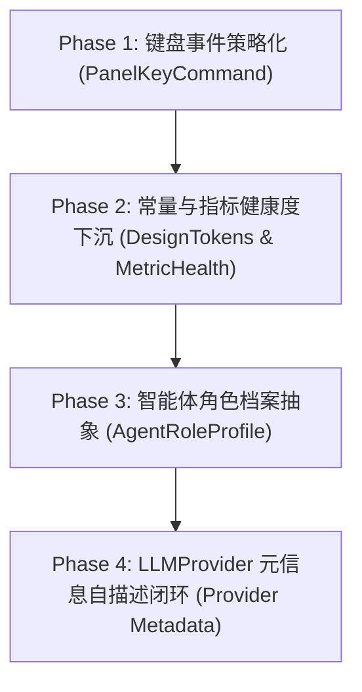

# QuickShow 架构重构与 SOLID 开闭原则治理蓝图

> **文档定位**：本规范是 QuickShow 工程遏制代码腐化、消除魔法数字、统一场景与类型派发的**长期对照与重构实施基准**。任何新增业务能力与重构改动均须以此为准绳，严格对齐 SOLID 原则与面向协议的策略扩展体系。

---

## 0. 核心设计原则与工程法则

### 1. SOLID 原则优先（尤其是开闭原则 OCP）
- **开闭原则（Open-Closed Principle, OCP）**：软件实体（类、模块、函数）应该**对扩展开放，对修改关闭**。
  - 新增一个供应商、一种卡片、一个按键命令或一个智能体角色时，**绝不应去修改现有的中央调度代码或上层调用方**，而应仅通过**新增一个遵循统一协议的实现类并将其注册到调度中心**来实现即插即用。
- **单一职责原则（Single Responsibility Principle, SRP）**：
  - 视图层（SwiftUI View）只负责“如何展示”（声明式布局与样式绑定）；
  - 领域模型（Model/Store）负责“数据状态与业务语义推导”（如当前指标是正常还是告警）；
  - 调度器（Registry/Dispatcher）负责“如何路由”，各司其职，坚决杜绝在 View 的计算属性里硬编码复杂的阈值判断与业务决策。

### 2. “第二次出现”工程法则（The Second-Time Rule）
- **第一次出现**：某个特化逻辑或简单场景分支初次引入时，可以保持轻量实现，不过度设计；
- **第二次出现**：系统内一旦出现**第二处同类场景判定、类型嗅探、前缀匹配或大块结构复制**，**严禁继续写第三个分支或再次复制**，必须立即停下来进行抽象设计，引入协议与注册中心分发机制。

### 3. 杜绝任何形式的魔法数字与硬编码
- 裸写键码（如 `keyCode == 46`）、业务阈值（如 `usage > 85`）、时间常量（如 `1.2` 秒）、布局数值等一律视为代码坏味道；
- 所有按键事件收敛为语义化枚举或强类型 Command；所有时间、颜色与网格常量收敛至 `DesignTokens.swift`（`Theme`）或领域策略模型。

---

## 1. 标杆案例：工程现有最佳实践解析

QuickShow 工程中已经存在三个严格践行 OCP 与策略模式的典范，后续所有模块治理均需以此三者为蓝本：

```
                    ┌─────────────────────────┐
                    │    Protocol (契约层)     │
                    │   - LLMProvider         │
                    │   - MarkdownBlockRenderer│
                    │   - RichCardProvider    │
                    └────────────▲────────────┘
                                 │ 实现实现
         ┌───────────────────────┼───────────────────────┐
         │                       │                       │
┌─────────────────┐     ┌─────────────────┐     ┌─────────────────┐
│ OpenAIProvider  │     │ GeminiProvider  │     │  QoderProvider  │
└────────▲────────┘     └────────▲────────┘     └────────▲────────┘
         │                       │                       │
         └───────────────────────┼───────────────────────┘
                                 │ 注册装配
                    ┌────────────┴────────────┐
                    │   Registry (注册中心)    │
                    │  根据类型/Key 动态查表分发   │
                    └────────────▲────────────┘
                                 │ 统一调用 (零分支)
                    ┌────────────┴────────────┐
                    │    Client (调用方)       │
                    │  AIChatService / View   │
                    └─────────────────────────┘
```

1. **`LLMProvider` & `LLMProviderRegistry`**（`QuickShow/AI/Providers/LLMProvider.swift`）：
   - **抽象**：将推理流、模型拉取、思考字段适配抽象为 `LLMProvider` 协议；
   - **分发**：`LLMProviderRegistry` 集中注册与查找，调用方 `AIChatService` 无需知道底层通信差异；
2. **`MarkdownBlockRegistry`**（`QuickShow/Views/Markdown/Core/MarkdownBlockRegistry.swift`）：
   - **抽象**：定义 `MarkdownBlockRenderer`（优先级、`canRender`、`renderWidget`、间距节奏）；
   - **分发**：AST 遍历时通过注册表按匹配度分发，新增 Markdown 语法块零侵入已有渲染器；
3. **`RichCardRegistry`**（`QuickShow/AI/RichCard.swift`）：
   - **抽象**：定义卡片信封 `RichCard` 与 `RichCardProvider`；
   - **分发**：根据信封 `type` 查找视图工厂，新增地图卡、天气卡、图表卡无需在会话视图增加 `if-else`。

---

## 2. 治理重灾区与重构蓝图对照

```
┌────────────────────────────────────────────────────────────────────────┐
│                        QuickShow 重构对照矩阵                          │
├──────────────────┬──────────────────────────┬──────────────────────────┤
│ 领域模块         │ 现状坏味道 (Before)      │ 重构方案 (After / OCP)   │
├──────────────────┼──────────────────────────┼──────────────────────────┤
│ 1. 键盘盲操事件  │ 20+ 分支裸 switch keyCode│ PanelKeyCommand 策略协议 │
│    (PanelManager)│ 充斥 46/126/0/8 等魔数   │ PanelKeyCommandRegistry  │
├──────────────────┼──────────────────────────┼──────────────────────────┤
│ 2. AI 供应商     │ 字符串 contains 猜图标   │ LLMProvider 扩充自描述   │
│    元信息与路由  │ 表单 3 处 switch type    │ 抹平散落的 hardcode 特判 │
├──────────────────┼──────────────────────────┼──────────────────────────┤
│ 3. 智能体与角色  │ switch roleId 映射工具   │ AgentRoleProfile 角色实体│
│    (AIAgent)     │ 针对 qoder/alibaba 复制代码│ 自适应 Provider 模型适配 │
├──────────────────┼──────────────────────────┼──────────────────────────┤
│ 4. 监控指标健康度│ View 散落 >85/>60 阈值   │ MetricHealthLevel 语义化 │
│    与公共常量    │ 1.2s 反馈时间硬编码 5 处 │ DesignTokens (Theme) 统一│
└──────────────────┴──────────────────────────┴──────────────────────────┘
```

---

### 重灾区 1：按键盲操事件链（`PanelManager.swift`）

#### 现状问题（Before）
在 `PanelManager.swift:121-190` 中，存在一个包含 20 多个分支的巨大 `switch keyCode`：
- **裸数字不可读**：`case 46`（M）、`case 126`（Up Arrow）、`case 0`（A）、`case 8`（C）、`case 35`（P）、`case 31`（O）、`case 7`（X）、`case 37`（L）、`case 2`（D）、`case 34`（I）、`case 18, 19, 20`（1/2/3）等；
- **业务优先级硬编码杂糅**：
  ```swift
  case 123: // ← 左方向键: 日历视图激活时优先翻页（覆盖媒体语义），否则媒体上一首
      if appState.currentContext == .calendar {
          appState.calendarPageBackward()
          return true
      }
      appState.mediaPreviousTrack()
      return appState.hasNowPlayingSession
  ```

#### 重构方案（After / OCP）

1. **强类型按键与命令协议**：
   ```swift
   /// 语义化键码定义（彻底消灭裸 UInt16）
   enum KeyEquivalentCode: UInt16, Sendable {
       case a = 0, d = 2, x = 7, c = 8, i = 34, p = 35, returnKey = 36, l = 37, o = 31
       case m = 46, comma = 43, dot = 47
       case num1 = 18, num2 = 19, num3 = 20
       case leftArrow = 123, rightArrow = 124, downArrow = 125, upArrow = 126
   }

   /// 键盘命令策略协议
   protocol PanelKeyCommand: Sendable {
       var id: String { get }
       var key: KeyEquivalentCode { get }
       var modifiers: NSEvent.ModifierFlags { get }
       var priority: Int { get } // 优先级数值越搞越先裁决
       
       /// 是否在当前应用状态与上下文中生效
       func canHandle(in context: PanelContext, state: AppState) -> Bool
       
       /// 执行动作，返回 true 表示消费该事件（不向底层系统传递）
       func execute(state: AppState) -> Bool
   }
   ```

2. **命令注册表分发总线**：
   ```swift
   @MainActor
   final class PanelKeyCommandRegistry {
       static let shared = PanelKeyCommandRegistry()
       private var commands: [PanelKeyCommand] = []

       func register(_ command: PanelKeyCommand) {
           commands.append(command)
           commands.sort { $0.priority > $1.priority }
       }

       func handle(event: NSEvent, context: PanelContext, state: AppState) -> Bool {
           guard let key = KeyEquivalentCode(rawValue: event.keyCode) else { return false }
           let currentModifiers = event.modifierFlags.intersection([.command, .option, .shift, .control])

           for command in commands where command.key == key && command.modifiers == currentModifiers {
               if command.canHandle(in: context, state: state) {
                   return command.execute(state: state)
               }
           }
           return false
       }
   }
   ```

3. **效果**：
   `PanelManager` 的键盘事件处理简化为一行：
   ```swift
   panel.onKeyDownAction = { [weak appState] event in
       guard let appState = appState else { return false }
       appState.resetGlanceTimer()
       return PanelKeyCommandRegistry.shared.handle(
           event: event,
           context: appState.currentContext,
           state: appState
       )
   }
   ```
   日历翻页命令、媒体切歌命令分别作为独立的 `CalendarPagingCommand` 和 `MediaTrackCommand` 注册，通过 `priority` 和 `canHandle` 优雅裁决，原文件零修改即可扩展按键。

---

### 重灾区 2：AI 供应商元信息与模型解析

#### 现状问题（Before）
- `AIProvider.swift:212`：通过字符串 contains 判定品牌图标：
  `if lowerId.contains("alibaba") || lowerName.contains("阿里") ...`
- `AIServiceSettingsForm.swift:785-812`：UI 表单硬编码三个 `switch type` 返回 placeholder、footer、格式化文案；
- `AIChatService+Streaming.swift:126` & `+Completion.swift:40`：两处完全相同的代码硬编码前缀特判：
  `if provider == nil && resolvedModelId.hasPrefix("qoder/") ...`
- `OpenAIProvider.swift:12-33`：通用协议实现内特判 `if provider.id == "alibaba"`。

#### 重构方案（After / OCP）

1. **让 `LLMProvider` 具备元信息自描述能力**：
   在 `LLMProvider` 协议中扩充配置元数据接口：
   ```swift
   protocol LLMProvider: Sendable {
       var providerType: AIProviderType { get }
       
       // --- 元信息与表单自描述 ---
       var brandIconName: String { get }
       var defaultEndpointURL: String { get }
       var endpointDescription: String { get }
       
       // --- 模型自洽推导 ---
       func matchesModel(modelId: String) -> Bool
       func defaultModelSpec() -> AIModelSpec
       func defaultPreset() -> AIProvider
       
       // --- 现有接口保持 ---
       func supportedAuthMethods(for provider: AIProvider) -> [any AIAuthMethod]
       func stream(...) -> AsyncThrowingStream<AIStreamEvent, Error>
       func fetchModels(...) async throws -> [String]
       func thinkingFields(...) -> [String: Any]
   }
   ```

2. **效果**：
   - `AIProvider.iconName` 直接调用：
     ```swift
     var iconName: String {
         LLMProviderRegistry.shared.provider(for: type).brandIconName
     }
     ```
   - `AIServiceSettingsForm` 彻底移除 `providerURLPlaceholder` 和 `providerURLFooter` 的 switch，直接取 `providerImpl.defaultEndpointURL` 和 `providerImpl.endpointDescription`；
   - `AIChatService` 匹配 Provider 时，使用多态 `providerImpl.matchesModel(modelId:)` 替代死板的 `hasPrefix("qoder/")` 前缀判断。

---

### 重灾区 3：智能体预设与角色工具（`AIAgent.swift`）

#### 现状问题（Before）
- `AIAgent.swift:47-63`：通过 `switch roleId` 判定工具列表；
- `SubagentTaskTray.swift:81-89`：通过 `switch task.subagentId` 判定图标；
- `defaultAgents(primaryProviderId:)`：复制粘贴了两份（Qoder 专用版 vs 阿里专用版），若使用 OpenAI 或本地端点，模型直接失效。

#### 重构方案（After / OCP）

1. **定义 `AgentRoleProfile` 实体**：
   ```swift
   struct AgentRoleProfile: Identifiable, Sendable {
       let id: String                  // "orchestrator", "coder", "librarian", etc.
       let name: String                // "全能助理", "代码专家", etc.
       let iconName: String            // "sparkles", "curlybraces", etc.
       let description: String
       let systemPromptTemplate: String
       let defaultTools: [String]
       let defaultThinkingLevel: ThinkingLevel?
       let isVisualDelegate: Bool
       
       /// 推荐模型映射策略（根据目标 Provider 类型自适应选用对应强力模型）
       let recommendedModelPicker: @Sendable (AIProvider) -> String
   }
   ```

2. **建立 `AgentRoleRegistry` 角色预设中心**：
   集中定义 6 大核心角色的标准 Profile：
   - 任何地方读取角色的默认工具：`AgentRoleRegistry.shared.profile(for: id)?.defaultTools`；
   - 任务托盘读取图标：`AgentRoleRegistry.shared.profile(for: task.subagentId)?.iconName`；
   - 生成预设团队：单套循环遍历 6 大 Role Profile，并调用 `role.recommendedModelPicker(provider)` 自动装配对应 Provider 最佳模型（无论是 Qoder、Alibaba、Gemini 还是 OpenAI），代码量从 200 行复制缩减为 15 行纯净组合。

---

### 重灾区 4：监控状态健康度与魔法数字收敛

#### 现状问题（Before）
- `PerformanceCard.swift` 中裸写 `usage > 85`、`usage > 60`；
- `StatusBarView.swift` 中裸写 `pct <= 15`、`pct <= 35`、`pct <= 65`、`pct <= 85`、`percentage <= 20`；
- 复制成功的反馈复位：`DispatchQueue.main.asyncAfter(deadline: .now() + 1.2) { copied = false }` 散落在 5 个独立的 View 中。

#### 重构方案（After / OCP）

1. **指标健康度语义模型 `MetricHealthLevel`**：
   ```swift
   enum MetricHealthLevel: Sendable {
       case normal
       case warning
       case critical

       var color: Color {
           switch self {
           case .normal: return Theme.Colors.accent.opacity(0.95)
           case .warning: return Color.orange.opacity(0.95)
           case .critical: return Color.red.opacity(0.95)
           }
       }
   }
   ```
   下沉至 `SystemPerformanceInfo` 与 `BatteryInfo` 计算：
   ```swift
   extension SystemPerformanceInfo {
       var cpuHealth: MetricHealthLevel {
           if cpuUsage > 85.0 { return .critical }
           if cpuUsage > 60.0 { return .warning }
           return .normal
       }
   }
   ```
   View 只需书写 `.foregroundColor(appState.performanceInfo.cpuHealth.color)`，无需在 UI 层关心阈值。

2. **设计令牌与常量收敛至 `DesignTokens.swift`**：
   ```swift
   extension Theme.Motion {
       /// 复制成功、临时气泡等瞬态反馈保留时长
       static let transientFeedbackDuration: TimeInterval = 1.2
   }
   
   extension Theme.CalendarMetrics {
       static let monthGridCellCount: Int = 42
       static let weekGridCellCount: Int = 7
   }
   ```

---

## 3. 分阶段实施演进路线图（Roadmap）

为了保证重构期间的极高稳定性，实施采用**渐进式、可独立编译验证**的 4 个阶段：



| 阶段 | 治理模块 | 预期成效 | 验证指标 |
| :--- | :--- | :--- | :--- |
| **Phase 1** | 键盘盲操总线 | 彻底消除 `PanelManager` 巨型 `switch keyCode`，消灭 20+ 裸数字 | `PanelManager.swift` 按键分发收敛至 5 行代码，快捷键行为 100% 保持 |
| **Phase 2** | 常量与指标健康度 | 消除 5 处 `1.2s` 硬编码与 View 层阈值判断，指标健康度语义化 | `PerformanceCard` 与 `StatusBarView` 纯净声明式，零逻辑阈值 |
| **Phase 3** | 智能体角色档案 | 消除 `AIAgent` 200 行重复代码与多处 `switch roleId` | 智能体预设单循环生成，自适应任何新服务商模型 |
| **Phase 4** | AI Provider 元信息闭环 | 消除 `AIProvider` 字符串模糊匹配与 `AIServiceSettingsForm` 的 3 个 `switch type` | 新增 Provider 仅需实现协议并在 Registry 注册一行即可全系统生效 |

---

## 4. 实施对照与验收准则

在完成每一阶段重构时，必须满足以下验收标准：
1. **零回归（Zero-Regression）**：原有快捷键响应、流式会话、智能体调度、监控卡片数据刷新完全一致；
2. **纯原生构建通过**：运行 `xcodebuild -project QuickShow.xcodeproj -scheme QuickShow -configuration Release -destination 'platform=macOS' -derivedDataPath ./build build` 零警告、零报错；
3. **重启验证通过**：运行 `./scripts/restart.sh`，拉起最新产物实机验证。
